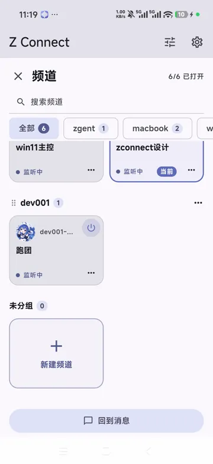
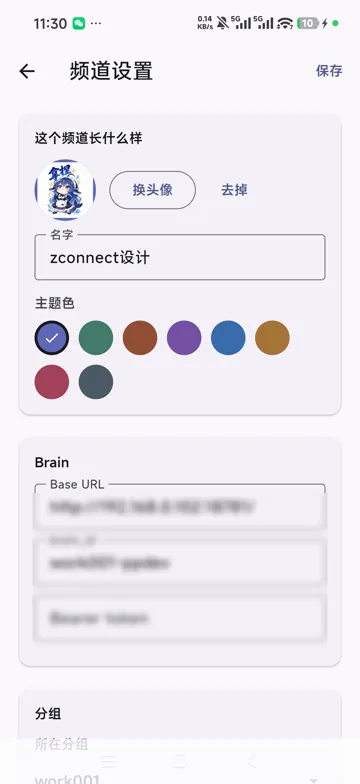
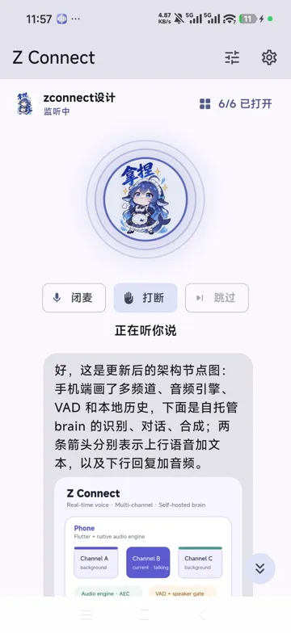

# Z Connect

[English](README.md) · [中文](README.zh.md) · 日本語

自分でホストするリアルタイム音声アシスタントクライアントです。スマホ側がやることは二つだけ——**録音と再生**。認識・対話・音声合成はすべて自分のサーバー（コードでは **brain**）で動きます。

**Push and Pull**。人とエージェントの両側が、それぞれ push し、それぞれ pull します。スマホはあなたの音声を brain に push し、長いポーリングで返事を pull します。エージェントはテキストを push し、人のテキストを pull します。四本のチャネルが同時に開いているので、協働は非同期です——あなたが話している最中でも、エージェントは話し始められます。

> **Made with deepseek v4.1 flash and Z Connect itself.**
> このプロジェクト自体の開発も Z Connect で回しています。スマホに向かって話すことでコーディングを駆動し、要件もレビューも修正も音声で進めました。

---

## スクリーンショット

<table>
  <tr>
    <td align="center" width="33%">
      <br>
      <sub>チャンネルとグループ</sub>
    </td>
    <td align="center" width="33%">
      <br>
      <sub>チャンネル設定</sub>
    </td>
    <td align="center" width="33%">
      <br>
      <sub>メッセージ内のインライン SVG</sub>
    </td>
  </tr>
</table>

## クイックスタート

1. [pp1](https://github.com/thautwarm/pp1) でコントロールサーバーを起動します。
2. アプリ（Android arm64、macOS Apple Silicon、または Windows 10/11 x64）をインストールし、サーバー URL とトークンを入れてチャンネルを作成します。
3. [声紋作成ページ](https://thautwarm.github.io/zconnect/enroll/)で声紋を作成して読み込み、電源ボタンで聞き取りを開始します。

## これは何か

いつでも話しかけられる音声アシスタント。自宅の brain 上で動き、データは自分のサーバーの外に出ません。

- **全二重**：ユーザーが話している間も AI は聞き、AI が話している間もユーザーは聞く。両方向が同時に開いています
- **割り込み**：AI が話している途中でユーザーが話し始めると、すぐに止まります。そのとき「どこが聞こえなかったか」を brain に伝え、話し終えたことにはしません
- **バックグラウンドで継続**：別のアプリに切り替えても、画面をロックしても会話は続きます（フォアグラウンドサービスが録音を保持）。動画や音楽など他のアプリが音声フォーカスを取った場合は、接続を切らずに音声を一時停止し、戻ったら再開します
- **端末側の区間検出**：Silero VAD がスマホ上（Rust）で動き、文が完結した区間だけを送ります。連続した音声を丸ごとストリーミングするのではありません
- **声紋ゲート**：作成した声紋とその区間の音声の ECAPA コサイン類似度を計算し、十分に長い文がしきい値を下回れば区間ごと破棄します。家族の声はアップロードされず、エージェントのコンテキストにも入りません
- **複数チャンネル**：チャンネルごとに brain 設定と独立した履歴を持ち、同時に動かせます。音声を出すのはフォーカス中の一つだけで、ほかはテキストのみ記録します

## プロジェクトサイトと声紋作成

プロジェクトサイト（製品紹介・アーキテクチャ・プライバシー。中国語 / English / 日本語）：

**<https://thautwarm.github.io/zconnect/>**

自分で brain を書きたい場合は、まずプロトコルから：

**<https://thautwarm.github.io/zconnect/brain-api/>**

話者識別には本人の声紋が必要です。作成ページ：

**<https://thautwarm.github.io/zconnect/enroll/>**

ブラウザで短い音声を録音し、`spkemb.f32` をダウンロードして、アプリの **設定 → 一般 → 話者識別** から読み込みます。録音も推論もブラウザ内で完結し、音声はアップロードされません。サイトのソースは `tools/voiceprint` にあり、アプリにも「声紋をローカルで作成してダウンロード」ボタンがあります。

## アーキテクチャ

**スマホ側は会話コンテキストを持ちません**——それはサーバー側にあり、チャンネルを切り替えれば別の会話になります。スマホに保存されるのは**表示用の履歴**だけで、どのリクエストにも含まれず、削除しても会話に影響しません。

| 層 | 技術 |
|---|---|
| UI / ビジネスロジック | Flutter（Dart 3.13） |
| 端末側の区間検出 | Rust + Silero VAD、flutter_rust_bridge 2.13 |
| 声紋ゲート | Rust + ECAPA コサイン類似度（int8 ONNX、23 MB）。声紋は `tools/voiceprint` の Web ページで生成 |
| 音声エンジン | Android ネイティブ（Kotlin）：AudioRecord / AudioTrack / AEC；macOS ネイティブ（Swift）：AVAudioEngine + VPIO AEC；Windows ネイティブ（C++）：WASAPI + Voice Capture DSP AEC |
| 上りエンコード | Ogg Opus 16 kHz（MediaCodec + MediaMuxer） |
| 下りデコード | 連続 Ogg Opus 24 kHz（独自の増分パーサー + MediaCodec）→ 16 kHz にリサンプル |
| サーバーとの通信 | HTTP + MessagePack。上りはリクエスト／レスポンス、下りは前書き（テキスト）+ 連続音声ストリーム |
| 履歴の保存 | NDJSON、1 MB ごとに分割、追記のみ |

**Android arm64 のみ**、minSdk 29。**macOS 14+（Apple Silicon）**と **Windows 10/11 x64** にもネイティブ音声エンジン（Swift/AVAudioEngine と C++/WASAPI、どちらも libopus/libogg と同じ Rust VAD）があります。Windows は OS 内蔵の Voice Capture DSP でエコーキャンセルし、使えない場合は半二重に自動フォールバックします。iOS の Dart 側の契約は用意済みですが、ネイティブ側は未実装です。

## ASR と TTS のカスタマイズ

コントロールサーバーを自分で動かすには、brain サーバー、OpenAI 互換の ASR 文字起こし API、TTS API（自分でホストするか、互換レイヤー経由）が必要です。[pp-brain-server](https://github.com/thautwarm/pp-brain-server) はリファレンス実装、[moss-tts-windowed](https://github.com/thautwarm/moss-tts-windowed) は 8 GB の GPU で TTS を動かせます。

## ビルド

前提：Flutter 3.47 以上、Android NDK、Rust ツールチェーン。

```bash
# 1. ONNX Runtime（Android 用の .so はリポジトリに含まれています。ホストで cargo test を回すときだけ必要）
tools/fetch_onnxruntime.sh

# 2. ビルド——新しく clone しただけなら NDK なしでビルドできます（jniLibs の .so は同梱）
flutter build apk --release

# 3. Rust のソースを変えたときだけ再実行（成果物も一緒にコミット）
tools/build_rust_android.sh
```

macOS（14+、Apple Silicon）。Xcode の Build Phases が次のネイティブ依存スクリプトを自動で実行します：

```bash
tools/build_opus_macos.sh   # 静的 libopus + libogg → macos/Vendor
tools/build_rust_macos.sh   # Rust VAD dylib + ONNX Runtime → macos/Frameworks
flutter build macos --release
```

Windows 10/11 x64。Visual Studio 2022 Build Tools（C++ ワークロード）、Rust、
Flutter のプラグイン symlink 用の開発者モードが必要です。その後：

```powershell
pwsh -File tools/build_windows.ps1   # miniaudio + libopus/libogg + Rust DLL + ORT
flutter build windows --release
```

出力は `build\windows\x64\runner\Release` で、リリースワークフローが
`zconnect-<version>-windows-x64.zip` にまとめます。Windows 版は未署名なので、
初回起動時に SmartScreen の警告が出ることがあります。

## リリース

GitHub Actions（`.github/workflows/build-release.yml`）は、`main` への push、
Pull Request、手動実行のたびに `flutter analyze` と `flutter test` を回し、
`ubuntu-latest` で arm64-v8a の release APK を、`macos-14` で Apple Silicon の
macOS アプリ（XCTest 付き）を、`windows-latest` で Windows x64 版をビルドします。
すべてワークフローの成果物として添付され、APK、macOS アプリ、Windows zip が
GitHub Release に入ります。

GitHub Release を公開するには、`pubspec.yaml` のバージョンに合わせたタグを
push します：

```bash
git tag v1.0.0
git push origin v1.0.0
```

手動実行時に `release_tag` を入力してリリースを作ることもできます。

## エンドツーエンドの自己テスト

リポジトリには、プロトコルに沿って手書きした**偽の brain** が入っています。サーバーなしで経路全体を動かせます：

```bash
tools/mock_brain.py
```

手書きの MessagePack 実装も同梱されており、プロトコルの理解がずれていないか確認できます。`/brain-to-human` は `[u32 ビッグエンディアン長][UTF-8 テキスト][1 バイト flags]` の前書きに続けて連続した Ogg Opus ストリームを返し、`skip_before`、`--no-audio`、`--truncate`、`--failed` に対応しています。

## ディレクトリ

```
lib/            Dart 側：設定、セッション、保存、UI
rust/           端末側の区間検出（Silero VAD）、話者ゲート（ECAPA）、frb バインディング
android/        ネイティブ音声エンジン、フォアグラウンドサービス、通知
assets/         モデル（ecapa.onnx、int8）
tools/          ビルドスクリプト、偽の brain、声紋作成 Web ページ、アイコン生成
docs/           設計・プロトコル文書
test/           ユニットテスト
```

## ドキュメント

| 文書 | 内容 |
|---|---|
| `docs/voice-assistant.md` | 要件と技術設計 |
| `docs/voice-engine.md` | ネイティブ音声エンジンと AEC |
| `docs/brain-api.md` | brain とのプロトコル（エンドポイント、ペイロード、履歴ページング） |
| `docs/handoff.md` | 決定事項、レビュー結果、既知の問題 |
| `docs/需求-闭麦与打断.md` | ミュートと割り込みの意味 |
| `docs/屏幕输出约定.md` | TTS 出力時の話し方の約束 |

## ライセンス

未定です。
